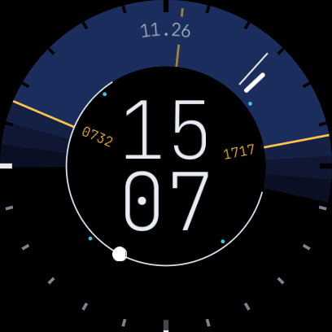
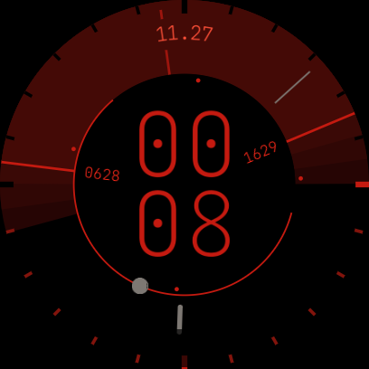

# Nightwatch

A 24-hour watch face for Wear OS: the sun, moon, and tides at a glance.

<p>
  
  
</p>

Website: [analemmic.com/nightwatch](https://analemmic.com/nightwatch/)

## What's here

- `face/`: the watch face, in Watch Face Format. `face/tools/gen_face.py` generates it.
- `astro/`: the companion app. It calculates sun, moon, and tide times on the watch and sends them to the face.
- `docs/`: the website.

## Build

Needs JDK 17+, the Android SDK, and Python 3 with Pillow. The face needs Wear OS 6.

```sh
python3 face/tools/gen_face.py
./gradlew :face:assembleDebug :astro:assembleDebug
```

Install both APKs on the watch, then choose Nightwatch as the watch face.

## License

© 2026 Analemmic. All rights reserved. The source is published for reference; see [COPYRIGHT](COPYRIGHT) and
[licenses](licenses/NOTICE.txt) for third-party components.

Not for navigation.
